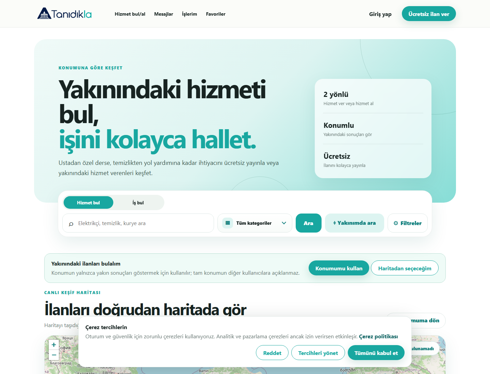
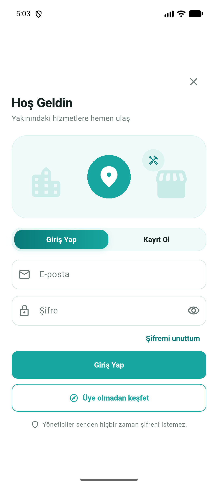
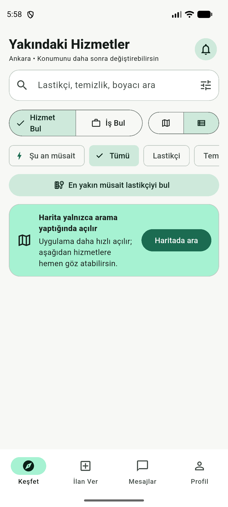
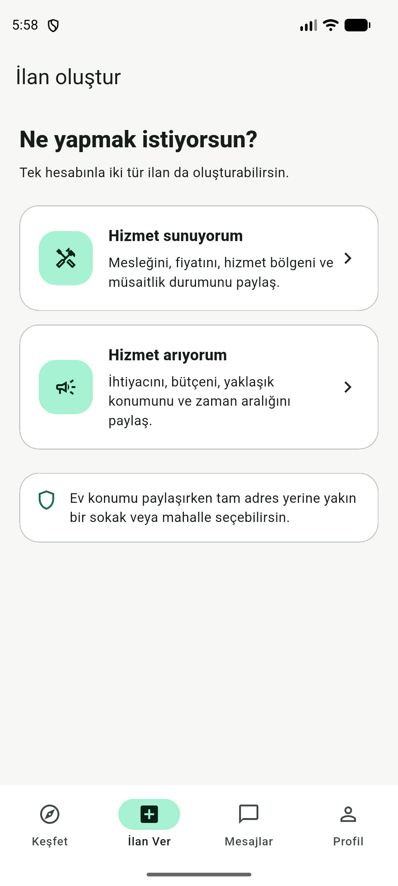

<p align="center">
  
</p>

<p align="center">
  A web and mobile local-services marketplace that connects customers<br>
  with nearby service providers through location-based discovery.
</p>

<p align="center">
  <strong>Flutter Mobile</strong> · <strong>Vanilla PHP Web/API</strong> · <strong>PostgreSQL</strong> · <strong>Admin Panel</strong>
</p>

## Website

The web interface includes service discovery, advanced filters, map and list
views, listing creation, favorites, messaging, and profile management. The same
PHP application also provides the versioned `/api/v1` REST API and an admin
panel with a separate authentication session.



## Mobile application

The Flutter application uses the same API and database as the website. Nearby
service discovery, service offer/request listings, messaging, notifications,
and profile operations work consistently across both clients.

<table>
  <tr>
    <td align="center"></td>
    <td align="center"></td>
    <td align="center"></td>
  </tr>
  <tr>
    <td align="center"><strong>Login and registration</strong></td>
    <td align="center"><strong>Nearby services</strong></td>
    <td align="center"><strong>Listing creation</strong></td>
  </tr>
</table>

## Repository structure

```text
tanidikla/
├── mobile/        Flutter mobile application
├── web-platform/  PHP website, REST API, and admin panel
└── docs/          Repository screenshots and shared documentation
```

```text
Flutter application ─┐
                     ├── /api/v1 (PHP) ── PostgreSQL
Website ─────────────┘          │
                                └── Admin panel
```

## Key features

- Location-based service and job listing discovery
- Map/list views with category and distance filters
- Service offer and service request listings from a single account
- Listing images, favorites, saved searches, and notifications
- Listing-based user messaging with real-time update support
- Web sessions, mobile access/refresh tokens, and CSRF protection
- Moderation, role-based permissions, reports, and audit logs
- Privacy/legal document versioning, data export, and account anonymization
- SEO-friendly listing/category pages, sitemap, and structured data

## Requirements

### Web/API

- PHP 8.4 or 8.5
- PostgreSQL (PostGIS is recommended for production)
- Composer
- PHP extensions: `curl`, `fileinfo`, `gd`, `mbstring`, `openssl`,
  `pdo_pgsql`, and `pgsql`

### Mobile

- Flutter SDK with Dart `^3.10.4`
- Android Studio or Xcode

## Running locally

### 1. Website and API

```powershell
cd web-platform
Copy-Item .env.example .env
composer install
php -c php.ini bin/migrate.php
php -c php.ini bin/seed.php
./dev.ps1
```

Local endpoints:

- Website: `http://127.0.0.1:8080`
- API health check: `http://127.0.0.1:8080/api/v1/health`
- Admin login: `http://127.0.0.1:8080/admin/giris`

### 2. Mobile application

```powershell
cd mobile
flutter pub get
flutter run --dart-define-from-file=config/api.local.json
```

The Android emulator reaches the local API through
`http://10.0.2.2:8080/api/v1`. To use a different server:

```powershell
flutter run --dart-define=API_BASE_URL=https://your-domain.com/api/v1
```

## Quality checks

```powershell
# Mobile
cd mobile
flutter analyze
flutter test

# Web
cd ../web-platform
node --check public/assets/app.js
php -c php.ini tests/seo-static-smoke.php
php -c php.ini tests/trust-marketplace-static-smoke.php
```

## Configuration and security

Real passwords, API keys, the local database, logs, and user uploads are never
committed to Git. Use `web-platform/.env.example` for web configuration and
`mobile/config/api.example.json` for the mobile API endpoint.

Before deploying to production, configure a strong `APP_KEY`, a dedicated
database user, HTTPS, SMTP, and a map tile provider suitable for production
traffic.

## Detailed documentation

- [Web/API setup](web-platform/README.md)
- [Production deployment](web-platform/docs/DEPLOYMENT.md)
- [API contract](web-platform/docs/api-contract.md)
- [Mobile architecture](mobile/docs/architecture.md)
- [Mobile application notes](mobile/README.md)

## License

This is a privately developed project. Unauthorized use, copying, or
distribution is prohibited.
